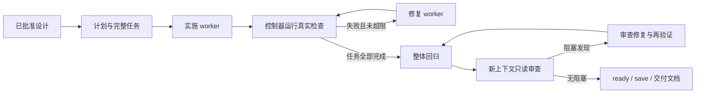

# Codex 无人值守驱动器（0.3）

现在有两种执行方式：会话内由 AI 连续推进，或显式启动独立控制进程。`new --mode unattended` 保存授权；`drive-start` 才启动后台。两者不应同时修改同一项目。

日常仍先讨论并确认设计。用户明确需要后台连续完成时，AI 配置真实检查命令、确认冻结选择、启动并交接报告；后续常规技术建议自动采用，有重要阻塞才等待。最终到交付准备，不自动推送、合并或发布。现有精确外部授权可由具备能力的宿主执行；当前驱动 worker 不执行这些动作。

## 启动示例

任务已经 init/new、设计 approve、scope 选择完成；已写计划则先 seal-plan。下面检查仅适用于确实用 unittest 的项目：

```powershell
'["python", "-B", "-m", "unittest", "-v"]' | Set-Content -Encoding UTF8 E:\MyProject\.gsp\checks.json
python E:\GstackSP\scripts\gsp.py --project E:\MyProject drive-init login --checks E:\MyProject\.gsp\checks.json --quote "用户实际的后台执行授权" --max-dispatches 20 --timeout 900 --max-seconds 14400
python E:\GstackSP\scripts\gsp.py --project E:\MyProject drive-start login
python E:\GstackSP\scripts\gsp.py --project E:\MyProject drive-status login
```

JSON 检查为 executable+argv，不拼 shell。Python 路径建议写绝对值。Codex 需已有可用 CLI 和登录；`--codex-bin` 可选指定。继续沿用已有模型配置，不要求新建付费 API。现有账户的实际调用仍按其计费方式消耗额度。

## 状态与文件流转



模型返回 completed 不等于任务完成。控制器验证 job ID、响应结构、进程退出、控制文件、真实检查与证据，然后登记进度。发现未知执行先停，不把缺失结果当作失败后随意重试。

| 文件 | 谁看、作用 |
|---|---|
| `docs/gsp/tasks/<id>/driver-report.md` | 人看当前状态、阶段、次数和恢复入口 |
| 同目录 `delivery.md`、`review.md`、`decisions.md` | 人看实际交付、发现及自主推荐记录 |
| 状态 documents 关联的 specs 规格、plans 计划（旧任务兼容旧目录） | 人确认目标；AI 取完整实施任务 |
| `.gsp/runs/<id>/driver/state.json` | AI/控制器恢复正本，不手改完成或预算 |
| `driver/gates/<uuid>.json` | 等待问题、单次答复及来源归因 |
| `driver/attempts/<uuid>/` | job/schema、响应、接受回执、本地 stdout/stderr |
| `driver/events.jsonl`、`driver/daemon.log` | 控制器事件和故障现场 |
| `driver/stop.json` | 独立停止请求，检查命令占用 writer lock 时仍可发送 |
| `.gsp/runs/<id>/evidence/` | 原有真实检查回执，驱动器继续复用 |

## 停止与恢复

普通问题按 gate 回答；未知执行先调查再恢复。完整参数与精确限制见源码 [驱动操作规则](../skills/gsp-workflow/references/driver.md)，也随 gsp-workflow 安装。

```powershell
python E:\GstackSP\scripts\gsp.py --project E:\MyProject drive-answer login --gate 当前ID --answer "实际答复" --quote "用户原话"
python E:\GstackSP\scripts\gsp.py --project E:\MyProject drive-stop login --quote "用户实际停止指示"
python E:\GstackSP\scripts\gsp.py --project E:\MyProject drive-recover login --evidence E:\MyProject\recovery.md --reason "已确认进程退出并核对部分修改"
python E:\GstackSP\scripts\gsp.py --project E:\MyProject drive-start login
```

answer/recover 后需要重新 start；不会偷偷唤起后台。max_fix_rounds 固化为每任务与审查修复链上限，初次实施不算修复；重启和恢复不清零。派发数、单次时限和绝对总截止均受限，金额尚不计量。上限耗尽会阻塞，而不是初始化覆盖旧记录。

检查命令也记录 PID 与创建身份。控制器中断后仍有活跃检查进程时拒绝恢复；已结束后保留原 inflight 调查记录，不把未知检查补记为通过。停止/超时保留部分修改，不能假定项目已自动回滚。

后台适用于本机持续开机的情形。Windows 若拒绝脱离父 Job 会明确失败；关机、睡眠和控制器自身崩溃后的自动重启不在本版。Claude headless 适配器尚未实现。当前只读/写入沙箱参数、进程拆分与结构化输出依据本机 CLI 帮助及 [Codex 官方非交互模式文档](https://learn.chatgpt.com/docs/non-interactive-mode)。这不等于对项目外写入或所有子进程提供完整安全隔离。
## 审查者标记说明

后台 Codex 审查登记为 `fresh-context`：使用新上下文，但不声称供应商独立。命令适配器/测试 fixture 继续标记 `self`。已有 `independent` 入口保持兼容，用于调用者实际核实的独立审查，不由驱动器自动登记。


0.6 worker 提示明确读取当前阶段完整 SP 技能与适配契约；计划/审查仍只读生成结果，控制器写入状态关联的正本。技能读取要求已接入提示，不等于已通过真实模型完整遵循验收。


## 新后台计划的接纳（0.8.9）

新后台计划由 worker 返回完整正文与匹配的任务列表。worker 做内容自查；主控负责登记任务、结构检查与封存，不要求只读 worker 执行 GSP 记账命令。

主控在 accepted.json、正式计划与任务写入之前，生成含实际 Spec 链接的候选正文，按 UTF-8 1 MiB 上限和现有 check_plan 核对。失败保留原始 response.json，并写同 attempt 的 rejected.json（job、响应哈希、quality）；不写 accepted，不改变绑定计划、任务与 seal。job.plan_findings 将结构诊断交给下一次规划。

结构缺项自动进入 plan 修复链：初次不计修复，重试派发前记入 fix_rounds.plan，复用 max_fix_rounds、总派发数与绝对截止时间，重启不清零。有效修复接纳后清除当前反馈与 pending_fix，保留历史次数，正常实施不继续计作计划修复。超过预算停止并报告原因；不能手改计数解除。

实际写入后仍以 seal-plan --check-structure 核对绑定正文。已有任务不能自动清空重建；旧无开关 CLI、已有封存和历史任务保持兼容。结构结果始终 semantic_review=NOT_CHECKED，不证明迁移方案、接口含义或需求覆盖正确。

格式不可信、状态改变、进程/文件写入中断仍属于未知执行，需要按 drive-recover 调查恢复。存在 accepted.json 或 rejected.json 的未完成接纳禁止直接重放；标记后持久状态写入失败也不能当成普通计划缺项重试。保留原始响应不等于其已被接纳。

恢复会核验 pending attempt 的拒绝记录（job、响应哈希及实际结构诊断），恢复原有计划反馈与修复链，预算不清零；不匹配报 PLAN_REJECTION_MISMATCH，必须继续调查。若计划已封存而驱动状态写入中断，核对 seal 后才转 execute、清除临时计划修复标志，历史 fix_rounds 保留。
