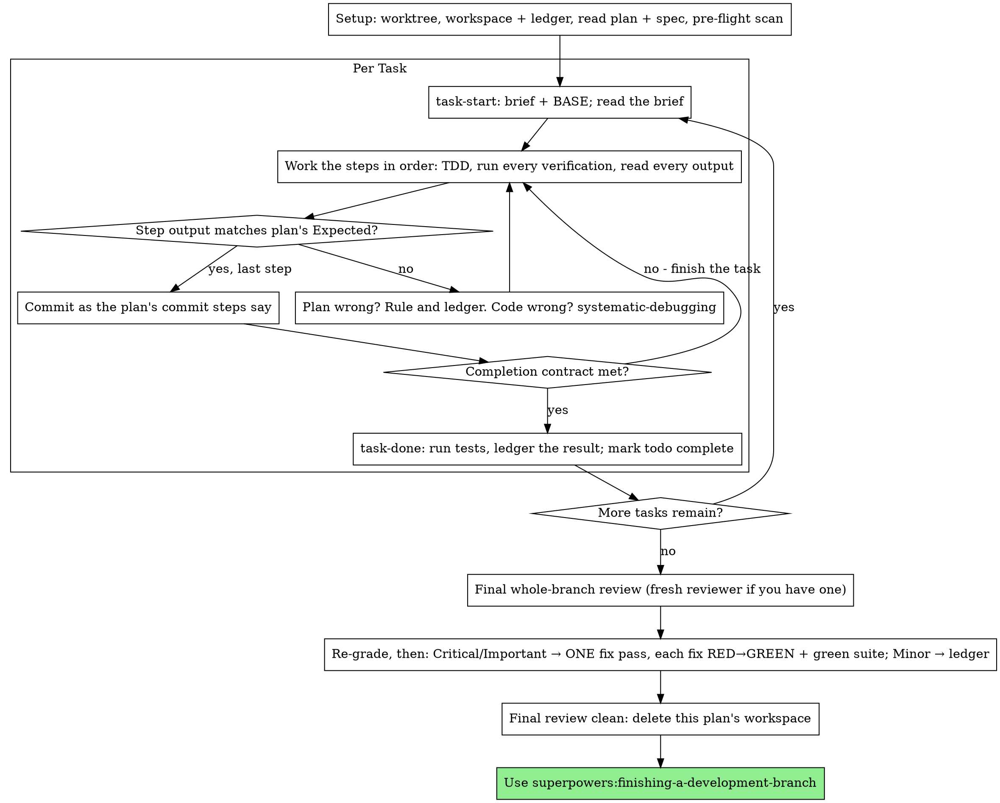

## GstackSP adaptation (only the explicitly listed differences)

Read the [SP adaptation contract](../gsp-workflow/references/sp-adapter.md) first. The complete upstream body follows, not a summary. Resolve upstream `superpowers:*` names using the contract; never load a second SP installation. Relative prompts/scripts are based on the corresponding ORIGINAL.md directory. Resource links below are redirected to the complete preserved files. Missing host capabilities must be reported honestly.

Artifact layout is adapted, not the method: use the paths returned by GSP status/resume. New tasks live in docs/work/<year>/<month>/<stable-folder>/ (spec.md, plan.md and stage artifacts); existing bindings stay authoritative. Read [document governance](../gsp-workflow/references/document-governance.md) for saved ideas, module relations, discovery, health reports and controlled migration. Do not create a second spec or plan at the upstream default path.

Use the [output and handoff contract](../gsp-workflow/references/output-handoff.md) for actual results, honestly attributed skills used, evidence, next action and owner. Return nested methods to the current task; continue authorized work without a redundant approval.

### GSP stage integration

会话内执行仍遵守修复纪律。用户明确需要脱离会话连续执行时，读取 [驱动器](../gsp-workflow/references/driver.md)，配置真实检查并使用 drive-init/drive-start；不要同时由会话和驱动器修改项目。Codex 驱动器持久消费 max_fix_rounds，按每个任务和最终审查修复链计数，初次实施不算修复；失败命令数不等于修复轮次。Claude 暂无 headless 适配器。未解决问题按共同待办规则保存并带入最终审查。首次写入前先运行 `<gsp> topology <id>`，向用户展示当前分支、HEAD、全部 worktree、脏状态和已有任务绑定，再用 `<gsp> topology-select <id> --mode in-place|branch|worktree --quote "用户原话"` 记录选择；默认阻止 main/master 或 detached HEAD 直接实现。每个 GSP 编号、T 任务、branch、commit SHA、control_root、workspace_root 和 Issue/PR 独立记录，前后端并行任务各用独立 worktree，由 integration 任务汇合后再 ready。 Native 会话支持绑定 worktree；当前 headless driver 不支持独立/子工作区，会返回 DRIVER_TOPOLOGY_UNSUPPORTED。子任务提交获授权并核对后使用 observe-head --task Tnn；集成树必须包含各子任务已验证提交，最终 run --task all 在集成工作区执行。 长命令或重定向 stdout/stderr 时必须记录日志路径、PID/exec session、状态/退出码来源和预期产物。相同空 write_stdin 最多等待两次；第三次前必须读取日志、检查进程、退出码或产物。等待时长变化不构成新观测，hook 可能以 wait-guard 拒绝第三次空等待。

## 跨会话开发（仅 `intent=cross-session`）

单会话仍是默认路径。没有 `cross-session` 意图的任务不创建 session registry、brief/report 目录，也不增加额外门禁。启用跨会话后，一个 GSP 工作项仍只有一份 `spec.md`、`plan.md`、`decisions.md`、`review.md` 和 `delivery.md`，这就是唯一总体计划及其配套记录。总体详细执行计划由 controller 主会话维护，它负责目标、非目标、任务图、依赖、公共接口、基线、worktree、允许和禁止路径、测试矩阵以及最终集成验收。子会话读取总体计划和自己的 brief，自主安排局部阅读、实现和局部测试顺序，不能复制 `plan-v2.md`，也不能替代 controller 做跨任务裁决。

使用 `<gsp> session-register` 分配稳定的 `S01`、`S02` 会话身份。`T01`、`T02` 仍是计划任务身份。controller 用 `<gsp> session-brief` 派发局部输入，worker 用 `<gsp> session-report` 回传 `DONE`、`BLOCKED` 或 `CHANGE_REQUEST`。换主会话只用 `<gsp> session-handoff` 接管同一 registry 和总体计划。报告替换前会把旧版本移入任务 `sessions/history/`，不会覆盖证据。

主会话发布时使用 `<gsp> session-dispatch`。它按依赖图批量计算 ready 任务，检查并发上限、`claimed_paths` 和路径重叠，并生成 `Dnnn`、预分配的 `Snn`、`Tnn-brief.md` 和 `Tnn-prompt.md`。没有显式 worktree 时，正式 worker 默认使用 `--worktree-mode auto`，GSP 创建受控的 managed worktree 和对应分支，并把实际路径、分支和基线写入 dispatch。显式 `--worktree` 或 `--worktree-mode bind` 只绑定宿主已有目录，GSP 取得写租约但不取得删除权。Codex 目标返回 `adapter-ready`，controller 再调用宿主原生线程创建、worktree 绑定、消息发送和有界等待入口。没有连接器的平台进入 `manual-required`，用户转发同一份 prompt。CLI 不伪造线程创建或外部消息发送。

controller 在发布前和进入等待时使用 `<gsp> session-progress`。摘要必须展示总体进度、发布次数、独立任务数、DONE 报告数、accepted 数、已清理 worktree 数、managed worktree 数、bound worktree 数、cleanup-pending 数、运行中、阻塞、CHANGE_REQUEST、待人工转发和下一阶段任务表。总体进度只按 `accepted_tasks / planned_tasks` 计算，不能把报告、接受或 prompt 生成冒充清理完成。

ZCode 作为用户级宿主时使用 `--host zcode` 安装到 `~/.zcode/skills` 和 `~/.zcode/AGENTS.md`，所有 ZCode 工作区共用同一份 GSP。`session-dispatch --target Tnn=zcode` 当前进入 `manual-required`，主会话把生成的 prompt 复制到 ZCode 子会话；子会话仍必须在指定 worktree 中工作并运行固定的 `session-report`，主会话再用 `session-watch` 和 `session-accept` 收口。这个安装范围不要求每个项目创建 `.agents/skills`。

`session-report` 会把结构化报告追加到 durable outbox。主会话或有界 watcher 使用 `<gsp> session-watch` 按事件 ID 消费，重复消费保持幂等。Codex 宿主用有界 `wait_threads` 等待，不要求 controller 进程全天轮询。主会话关闭时事件留在 outbox，下一次 resume 继续消费。controller 检查报告、测试和集成结果后，使用 `<gsp> session-accept <run> <task> --session <Snn>` 明确接受任务。`session-accept` 会记录接受事件、释放 worker lease，并按 worktree 所有权自动处理清理。干净的 managed worktree 会被移除并执行 prune，bound worktree 只释放租约并保留目录。

接受和清理是两个独立状态。managed worktree 遇到脏文件、锁定、Git 非零退出或未知结果时保留目录和分支，状态为 `cleanup-pending`，不计入 `cleaned_worktrees`。主会话随后使用 `<gsp> session-clean --retry` 重试 cleanup-pending。重复接受、释放或重试必须幂等。正常路径不要求用户手动删除 GSP 创建的 worktree，也不删除分支、commit、报告或显式绑定目录。

跨会话写入需要三层门禁。controller lease 保证同一任务只有一个主会话，worktree write lease 保证同一源码目录同一时刻只有一个可写会话，`--path` 声明和已接线的 direct-edit hook 在 Edit、Write、apply_patch 前复核会话身份、写租约和路径归属。未注册会话、未声明路径、租约冲突和重叠声明直接拒绝，分别返回 `SESSION_WRITE_LEASE_REQUIRED`、`SESSION_PATH_NOT_CLAIMED` 或 `SESSION_PATH_CONFLICT`。该机制不是文件系统沙箱。Shell、外部编辑器、MCP 或未接线宿主只能记录为 `NOT_CHECKED`，不能把事后 Git 指纹检查说成编辑前保护。

子 agent 与正式子会话必须区分。子 agent 是当前主会话内的临时辅助，不拥有独立 `Snn`、worktree、report 或恢复边界。正式子会话才计入 dispatch 统计，并拥有 `Snn`、`Tnn`、brief、report、outbox 和 worktree 清理生命周期。普通单会话任务不创建这些资料，原有 `new`、`approve`、`seal-plan`、`task-start`、`run`、`review`、`ready` 和恢复语义保持兼容。

Read these complete originals and their dependencies before using the corresponding mode:

- [subagent-driven-development](../gsp-workflow/upstream/skills/subagent-driven-development/ORIGINAL.md)
- [dispatching-parallel-agents](../gsp-workflow/upstream/skills/dispatching-parallel-agents/ORIGINAL.md)
- [using-git-worktrees](../gsp-workflow/upstream/skills/using-git-worktrees/ORIGINAL.md)

Before handing this stage onward, apply the [artifact fidelity checks](../gsp-workflow/references/artifact-fidelity.md) to the actual bound artifacts. Read the complete upstream method below; this integration is not its replacement. Plan authors use plan-check then seal-plan --check-structure after the upstream self-review. Structural success, preserved source text and a skills-used table do not prove semantic compliance.

Use the same artifact contract to route applicable engineering responsibilities from design to tasks, evidence and current documentation: data/recovery, configuration/dependencies, integration, project materials, delivery and maintenance. Expand only the topics triggered by this change; no extra mandatory table, document set or skill sequence. Headless plan workers return self-reviewed content; the controller owns registration and sealing.

Stage transitions use the unified controller: preview with `<gsp> handoff <id> --to <stage>` and advance with `<gsp> advance <id> --to <stage>`. Read `next_skill` and pending gates; do not treat chat text as a handoff or mutate workflow state around a failed advance.

<!-- sp-preserved-body:begin -->
# Executing Plans

Execute the plan yourself, task by task, in this session: no implementer
subagent per task, no reviewer per task. One fresh-context review of the
whole branch at the end.

**Why inline:** Subagent-driven development pays for a fresh implementer
and a fresh reviewer on every task, each re-reading the codebase from zero.
Inline execution pays for one context (yours) plus one reviewer at the end.
What it gives up is a fresh context per task and a second pair of eyes per
task. This skill keeps what those two things bought, by other means: the
brief is the spec, the ledger is your memory, TDD is the per-task gate, and
the final reviewer is the second pair of eyes.

**Core principle:** The plan already did the thinking. Execute it exactly,
prove each step with a test you watched fail and then pass, and leave a
record that survives your own forgetting.

**Narration:** between tool calls, narrate at most one short line — the
ledger and the tool results carry the record.

**Continuous execution:** Do not pause to check in with your human partner
between tasks. They chose inline execution to spend less, not to answer
"should I continue?" after every task. Execute all tasks from the plan
without stopping.

**Rulings, not stalls.** Conflicts, ambiguities, plan defects — decide them.
The spec is the binding authority, the plan is its argument, and your
judgment settles what neither answers. Record every decision in the ledger
as `Ruling: <what you decided> — <why> — <what it costs if wrong>`, and keep
going. Deviating from the plan without a ledgered ruling is a decision made
in secret.

Four things stop you, and only these: an irreversible or destructive
operation; a security-sensitive action; a side effect outside this worktree
that norms say you ask about first (a merge, a push to a shared branch, a
publish); and a plan so broken that every path forward is a guess. For
those, stop and ask.

## When to Use

- You have a plan from superpowers:writing-plans and your human partner
  chose inline execution at the handoff.
- Your harness has no subagent tool (see the per-platform references in
  `../using-superpowers/references/`). Never fabricate a dispatch; run
  the plan here.
- Tasks are mostly independent — the same precondition as
  superpowers:subagent-driven-development.

A fully specified plan makes inline execution transcription plus testing:
it runs well on a mid-tier session model, and the one place the most
capable model earns its cost is the final review, which this skill
dispatches separately. Tell your human partner so when they choose inline.

Prefer superpowers:subagent-driven-development when your human partner
wants a review gate on every task, or when the plan is long enough that
its later tasks would run on a compacted context. Inline execution over a
long plan still works — the ledger is what makes it recoverable — but the
last tasks get the least of you.

## The Process

## Setup

Ensure the work happens in an isolated workspace: use
superpowers:using-git-worktrees to create one or verify the existing one.
Never start implementation on a main/master branch without your human
partner's explicit consent.

Conversation memory does not survive compaction. An inline executor that
loses its place re-implements tasks whose commits already exist — the same
failure as a controller re-dispatching them, paid for in your own context.
Track progress in a ledger file, not only in todos. Harness todos are a
live view; the ledger is the record.

The workspace and ledger are shared with superpowers:subagent-driven-development
— same directory, same format — so a plan can change executors mid-flight
and the new one resumes from the same ledger.

- Each plan owns a workspace: at skill start, run
  `../subagent-driven-development/scripts/sdd-workspace PLAN_FILE` by its
  absolute path, from the working tree you're executing in — it
  prints the plan's git-ignored directory
  (`<repo-root>/.superpowers/sdd/<plan-basename>/`), home to every
  artifact for THIS plan: ledger, briefs, review packages. Another plan's
  directory is never yours to read or write.
- Check for this plan's ledger at `<workspace>/progress.md`. If its first
  line names your plan file, tasks with a `Task <N>: complete` line are
  DONE — do not redo them; resume at the first task without one. Their
  commits exist in git even when your context no longer remembers making
  them: after compaction, trust the ledger and `git log` over your own
  recollection. A ledger whose first line names a different plan file is
  another plan's progress: leave it and start your own, fresh.
- Create the ledger with its identity as the first line:
  `# SDD ledger — plan: <plan file path>`.
- `git clean -fdx` will destroy the workspace (it's git-ignored scratch);
  if that happens, recover from `git log`.

Read the plan once, note its context and Global Constraints, and create a
todo per task. If the plan names a Spec, read that too: the spec is the
authority the plan argues from, and conflicts inside the plan resolve
against it. A plan with no reachable spec gets a ledger note saying so —
rulings made without one are provisional.

**REQUIRED SUB-SKILL:** load superpowers:test-driven-development now,
before Task 1. It governs every step of every task below; a plan whose
steps already say "write the failing test first" does not exempt you
from reading it.

Before Task 1, scan the plan for conflicts between tasks. The plan's
Interfaces blocks tell you where to look: for every task that consumes
what an earlier task produces, one ledger row — the two tasks, what one
produces against what the other consumes, and what you found. Tasks that
share nothing get no row; a plan whose tasks share nothing gets the single
line `Pre-flight: no shared interfaces`. Rule on each conflict a row
surfaces with the spec as the binding authority, record the ruling beside
its row, and start Task 1. Each task's own text is checked when you read
its brief, not here.

## The Task Loop

Everything you print, and every tool result, stays resident in your
context for the rest of the session. Redirect long test output to a file
in the workspace and read its tail; read a brief, not the whole plan.

### 1. Take the task

- Run this skill's `scripts/task-start PLAN_FILE N` by its absolute path,
  from the working tree you're executing in. It prints the brief
  path and BASE (the commit the task's range is cut from) in one call.
  Read the brief for every task, including ones you remember from setup:
  what you remember is a summary, the brief has the exact values,
  signatures, and test cases.
- Mark the task's todo in_progress.

Every tool call is a turn that re-reads your whole context. Bookkeeping
rides along with work — a ledger append in the same call as the commit,
never in a call of its own.

### 2. Work the steps

The plan's steps are already in RED-GREEN order; follow them in that
order under superpowers:test-driven-development, loaded at setup. A test
step's code is written first and run first. Watching it fail is a step,
not a formality — a test that passes before the implementation exists is
a finding about the test.

Every step that runs a command has an `Expected:` line. Run the command,
read its output, and compare. Three outcomes:

- **Matches.** Next step.
- **The code is wrong.** Use superpowers:systematic-debugging. Find the
  cause; never patch the symptom to make the step's output match.
- **The plan is wrong** — a step contradicts the spec, an interface from an
  earlier task doesn't match what this task consumes, a command that
  cannot work. Rule on the smallest change that satisfies the spec, ledger
  it as `Task <N>: Ruling: <finding> — <what you decided and why>`, and
  continue. The ruling is carried, not remembered: later tasks that touch
  the same interface read it from the ledger.

Commit as the plan's commit steps say. A task that spans several commits
is fine; BASE is what the review range is cut from, never `HEAD~1`.

### 3. The completion contract

Before a task's ledger line, all of the following are true, with evidence
in this session — not inferred from the diff looking right:

- Every test the brief names exists and ran in this task, and you read
  the output.
- The final test run for the task passed — `task-done` is that run, and
  it writes the command and result into the ledger line.
- Every `Expected:` line in the brief was compared against real output.
- Every deviation from the brief has a `Ruling:` line in the ledger.

**REQUIRED SUB-SKILL:** superpowers:verification-before-completion governs
the claim. If any item is missing, the task is not complete: finish it.

### 4. Complete the task

Run this skill's `scripts/task-done PLAN_FILE N BASE -- <test command>`
by its absolute path, from the working tree you're executing in, with the test command the brief names for the whole task. It runs the
tests, keeps the full output in the workspace, prints the tail, and — only
if they pass — appends the completion line to the ledger:

`Task <N>: complete (commits <base7>..<head7>, tests: <command> → <result>)`

A failing run records nothing; the task is not complete. When it records,
mark the todo complete and take the next task.

## Final Review

Run `../subagent-driven-development/scripts/review-package PLAN_FILE MERGE_BASE HEAD`
by its absolute path, from the working tree you're executing in (MERGE_BASE = the commit the branch started from, e.g.
`git merge-base main HEAD`) and review from the file it prints.

**With a subagent tool:** dispatch the reviewer on the most capable
available model — the whole-branch review is a judgment task — using
superpowers:requesting-code-review's
[code-reviewer.md](../gsp-workflow/upstream/skills/requesting-code-review/code-reviewer.md), with the
package path, the plan and spec paths, the plan's Review Focus section
verbatim if it has one (the input classes and failure modes the plan's
tests do not exercise — the reviewer checks each deliberately), and a
pointer to the ledger's `Ruling:` lines so it can weigh the calls you
made. Specify the model
explicitly; an omitted model inherits the session's, which may not be the
most capable. This is the one fresh context the whole run buys. Do not
skip it, and do not replace it with your own read of the diff.

**Without a subagent tool:** read code-reviewer.md and perform that review
yourself against the package, as a separate pass after the last task's
ledger line. Write `Final review: self-review (no subagent tool)` to the
ledger, and say so in your final message: a self-review by the author is
weaker than a fresh reviewer, and your human partner decides whether that
is enough before merge.

Sort the findings before you act on any of them. The reviewer's severity
labels are advice; the gate is yours. Its "Declined to judge" list is
yours too: every line there is a ruling you make and ledger, exactly like
a plan conflict — `Final: Ruling: <behavior the reviewer set aside> —
<what a reasonable person using this software gets, and why that stands
or why it is now a finding> — <cost if wrong>`. Re-grade first, by effect: the
spec is a vision document, and a finding's grade is what a reasonable
person using this software gets if it ships, not whether the spec names
the input that triggers it — a reviewer who set a finding at Minor
because the spec was silent has graded the spec, not the effect. Then:

- **Critical and Important** enter the fix pass.
- **Minor** goes to the ledger as `Final: minor (deferred): <one-liner>`
  and to your final message under "Deferred minors". Minors never enter
  the fix pass, and never become rulings — a ruling is a decision about a
  conflict, not a note that you declined a polish suggestion.

Fix the Critical and Important findings yourself — you are the
implementer here — in ONE pass. Each fix is verified by TDD, not by a
second reviewer: write the test that reproduces the finding, watch it
fail, make it pass, then run the whole suite. Record each in the ledger as
`Final: fixed <finding> — <test name> RED→GREEN, suite <N>/<N>`. A fix
without a test that failed first is not verified; a suite that is not
green after the pass means the pass is not over. Do not dispatch a
re-review: it would re-read a diff whose covering tests already answer
"addressed" and whose suite run already answers "broke nothing".

A finding you decide not to fix is a ruling — `Final: Ruling: <finding> —
<why the code stands> — <cost if wrong>` — and reaches your human partner
in the rulings list. There is no second fix pass.

## Finish

Before you delete anything, collect every ledger line containing
`Ruling:` into your final message under "Rulings I made", in the order you
made them, each with what it costs if wrong, and every `minor (deferred)`
line under "Deferred minors". Both lists are exhaustive. Your final
message is the only place the decisions you took on your human partner's
behalf — and the findings you chose not to act on — reach them.

When the final review is clean and its fixes are committed, delete this
plan's workspace directory — the git history is the record now. Sibling
directories belong to other plans; leave them alone.

Use superpowers:finishing-a-development-branch.

## Common Rationalizations

| Excuse | Reality |
|--------|---------|
| "I remember what Task N says" | You remember a summary. The brief has the exact values. Read it. |
| "The plan's code is right, skip watching the test fail" | A test you never saw fail proves nothing. It is one step. Run it. |
| "I'll run the full suite at the end instead of per step" | Per-step runs are how you learn which step broke it. The end-of-task run is the contract, not a substitute. |
| "The plan is wrong here, I'll just do the right thing" | Do the right thing and ledger the ruling. Unledgered deviation is a decision made in secret. |
| "I'll write the ledger lines after a few tasks" | Compaction does not wait for a convenient moment. One line per task, in the same message as the commit. |
| "Let me check in before the next task" | They chose inline to spend less. Progress prompts spend their time instead. Only the four stops stop you. |
| "I read my own diff carefully; the final reviewer is redundant" | Same author, same blind spots. The reviewer is the only fresh context this run buys. |
| "Tests should pass, the change was trivial" | "Should" is not evidence. The contract requires the command and its output. |
| "Subagents are slow and expensive, I'll skip the final review too" | Inline already removed the per-task reviewers. One review of the whole branch is the floor, not the ceiling. |
| "The reviewer said Minor, so it's Minor" | The label graded the spec's silence. Grade what the person gets. Re-grade, then gate. |
| "The fix is obvious, no need for a failing test first" | The failing test is the only proof the finding was real and is now gone. Without it you have a diff and a hope. |
| "I'll fix the minors too while I'm in there" | Every minor you fix is a test, a fix, and a suite run your partner did not ask for. Ledger them; your partner decides. |

<!-- sp-preserved-body:end -->
